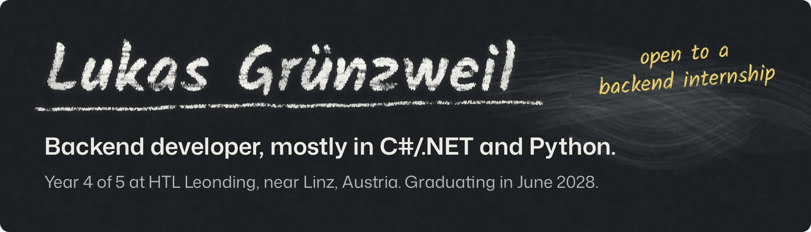
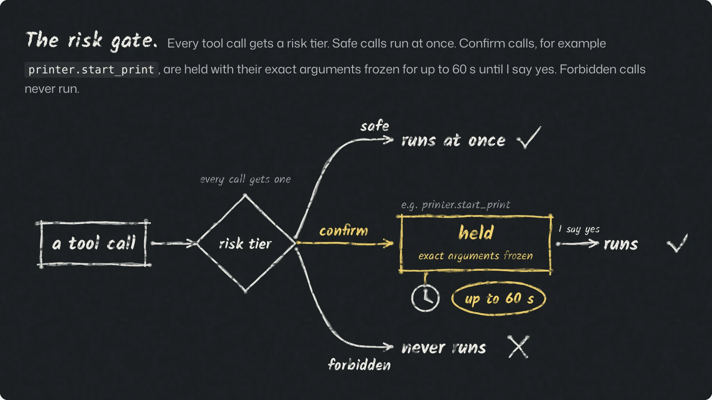
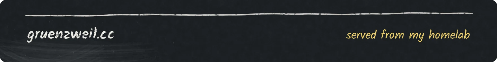

Most of what I build runs on a server, and lately a lot of it has a language model somewhere in the loop. The rest of the time I'm in Unity, which often ends in a tool for other Unity developers.

## About me

I'm Lukas, a student at HTL Leonding. I got into this through game dev and never stopped enjoying it. These days most of my time goes into backend systems and tooling, and every so often into a robot.

I think developer experience is a feature, not a nice-to-have. A teammate should get what a tool does in the first ten seconds. If I have to jump between twenty windows and three docs to figure it out, I've already decided I hate it.

Most of my projects started because something annoyed me.

## What I work on

### Marshal

[**Marshal**](https://github.com/lGruenzweilHTL/marshal) is a self-hosted AI agent for Home Assistant. It runs the 3D printer, sorts mail, prepares the morning and remembers what matters. Harmless actions just happen; risky ones wait for a clear yes.

- An ASP.NET harness every request goes through: agent loop, tool registry, model router, MCP client.
- A risk engine tiers every tool call. Safe calls run, confirm waits with its exact arguments frozen until I approve, forbidden never runs.
- Durable background tasks and a long-term memory with hybrid retrieval on SQLite and sqlite-vec, with a Vue web app on top.

C# / ASP.NET Core / SQLite / Vue / TypeScript

### Also active

- [**This website**](https://github.com/lGruenzweilHTL/portfolio-site): one FastAPI process on my homelab serves [gruenzweil.cc](https://gruenzweil.cc), the résumé PDFs, the assistant, the analytics and a feedback form. A GitHub webhook redeploys it on every push.
- [**naollm**](https://github.com/lGruenzweilHTL/naollm): connects a [NAO](https://en.wikipedia.org/wiki/Nao_(robot)) robot to a local AI agent and speech-to-text. Still the most fun way I've found to watch a robot walk into a wall.
- [**SceneForge AI**](https://github.com/lGruenzweilHTL/SceneForge-AI): a Unity editor assistant that turns model output into a diff of proposed scene changes. You review the diff, tick what you want, and only then does anything move.

### Earlier

- [**vektorgrid**](https://github.com/vektorgrid-ai): Marshal's predecessor, a self-hosted voice assistant built as a distributed system: a C# orchestrator, stateless Python inference workers, satellite microphones and an Android companion for approving tool calls. I wanted my own Jarvis, and a reason to use four programming languages in one project. What I learned: don't hand-write the speech pipeline and the satellite protocol. They took most of the time and weren't the interesting part.
- [**browser-webrtc**](https://github.com/lGruenzweilHTL/browser-webrtc): a WebRTC client and Python signaling server, the successor to an earlier SFU-server version of the same idea.
- [**lego-spike-serial**](https://github.com/lGruenzweilHTL/lego-spike-serial): a command interpreter for a LEGO Spike over serial. Good exercise in writing a real protocol for hardware that gives you no feedback.
- [**UniConsole**](https://github.com/lGruenzweilHTL/UniConsole): an in-game debug console and command runner for Unity.
- [**Unity.md**](https://github.com/lGruenzweilHTL/Unity.md): a markdown renderer for the Unity inspector.

### In progress, not public

- A game about doing government missions as a pigeon. It's in a private repo getting a rework, so I can't show it off yet.

## Stack

**Languages:** C# / Python / TypeScript / C / C++ / Kotlin / Java

**Tools and infrastructure:** ASP.NET Core / FastAPI / SQLite / Docker / Proxmox / Azure / Unity

## Get in touch

- [gruenzweil.cc](https://gruenzweil.cc) · [résumé (PDF)](https://gruenzweil.cc/resume.pdf)
- [lukas.gruenzweil@liwest.at](mailto:lukas.gruenzweil@liwest.at) · personal
- [l.gruenzweil@students.htl-leonding.ac.at](mailto:l.gruenzweil@students.htl-leonding.ac.at) · school

